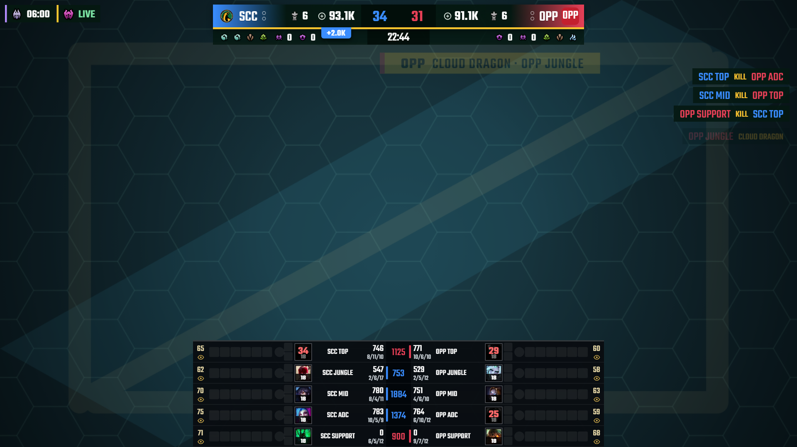
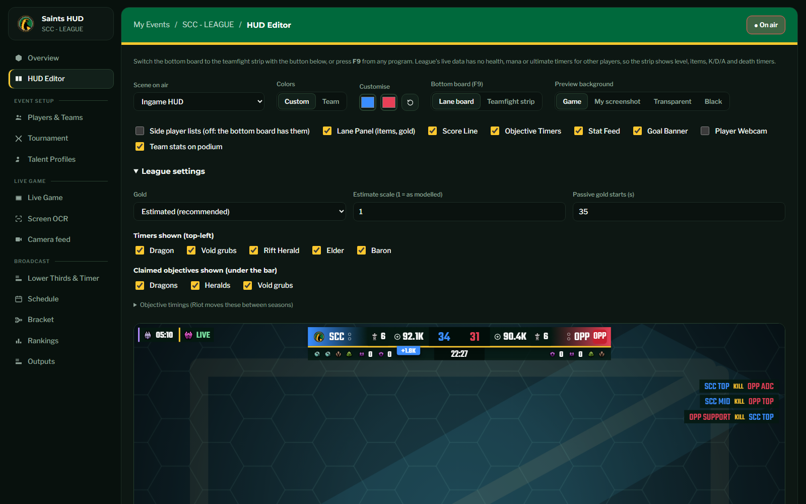

# Chud Hud

Live broadcast graphics for St. Clair Saints esports. One desktop app runs the control room, reads the game while you produce the show, and feeds your stream three ways:

1. **Ready-made overlays**: a 1920×1080 browser source with 13 scenes (in-game HUD, lineups, bracket, schedule, standings, lower thirds, caster nameplates and more). Drop it into OBS or vMix and switch scenes from the control room while live.
2. **Data for vMix / GT Title Designer**: every on-screen value as named fields in JSON, XML and CSV, updated every second as files and as URLs, so you can drive your own titles.
3. **An open feed**: any program can post Stats API–shaped JSON to the app, so games without official data can still drive the HUD.





## What it reads

| Game | Where the data comes from | Setup |
|---|---|---|
| **Rocket League** | The game's official Stats API: score, clock, overtime, boost, goals, assists, saves, demos, replays, the spectated player | One line in the game's `.ini`, see [Rocket League](#rocket-league) |
| **League of Legends** | Riot's Live Client Data API: live games, spectating and replays | None |
| **Minecraft** (Hunger Games, Build Battle) | The server's RCON port and `latest.log`, or the screen | Enter the server on the Minecraft page, see [Minecraft](#minecraft) |
| **Overwatch 2, Call of Duty, Deadlock, Fortnite, Valorant, Counter-Strike 2** | Screen OCR: scores, the clock and team names read from your capture | Draw boxes once, see [Screen OCR](#screen-ocr-other-games) |
| **Riftbound** (card game) | Operator-driven scoring, cards and clock | None, see [Riftbound](#riftbound) |
| **Anything else** | `POST /api/ingest` | See [Other trackers](#other-trackers) |

Every event is live at the same time and reads the feed of its own game, so a Rocket League event, a League event and a Minecraft event can all be on stream together. Each event's **Live Game** page can instead pick another source (screen OCR, the external feed, or a **Test match**, which is clearly marked). Events of the same game share that game's feed.

## Install

Download **`ChudHud-Setup-x.y.z.exe`** from the [latest release](https://github.com/McJanrey/saints-hud/releases/latest) and run it. Windows may show "Windows protected your PC" because the app isn't code-signed: choose **More info → Run anyway**. No administrator rights, Node.js or Python needed.

The app always starts on a small launcher, the only window at first: update status, **Quick Join** (pin events with **+ Add**, then one click opens the control room straight inside that event), **Open Control Room**, and the overlay link of every event with a **Copy link** button. Opening the control room replaces the launcher, so only one window is open at a time; **Help → Launcher** goes back. Signing in saves a **local profile** (name and email) on this PC; there is no account server.

### Updates

The app checks GitHub Releases on launch and every hour. Nothing downloads or installs on its own:

1. When a newer version exists, the launcher shows **Update available (vX.Y.Z)**.
2. **Download update** downloads it with a progress bar. The download is verified against the SHA-512 published with the release; a file that doesn't match is rejected.
3. **Update & Restart** first copies your events, teams, settings and uploads to `backups\pre-update-…` inside the data folder (the newest five are kept). If that backup fails, the update is not installed and your data is untouched. Then it installs silently and reopens the app.

A restart briefly takes the overlay offline in OBS, which is why the app never does it behind your back. **Help → Check for updates** checks right away. This flow arrives with 0.3.1; copies older than that still use the earlier automatic download.

### Where your data lives

`%APPDATA%\Chud Hud\data` (**File → Open data folder**). Updates and reinstalls keep it.

| Item | Purpose |
|---|---|
| `db.json` | events, teams, players, talent, schedule, bracket, settings |
| `uploads\` | logos, avatars, portraits you uploaded |
| `output\events\<event id>\` | each event's own `hud.csv`, `hud.json`, `hud.xml`, rewritten every second (`output\hud.*` follows the first event, for older vMix setups) |
| `backups\` | automatic copies taken before each update |
| `objective-icons\`, `ddragon-img\` | League icons, downloaded once and kept so the overlay works offline |
| `launcher.json` | your local profile and launcher preferences |

## Add the overlay to OBS

There is no "on air" switch: every event has its own overlay link and all of them are live at once. Copy an event's link from the launcher, from **File → Copy overlay link**, from **Copy overlay link** at the top of the control room, or from **Outputs**, then add a **Browser** source in OBS:

- URL: `http://localhost:7777/overlay?scene=auto&event=<event id>` (the app has to be open)
- Width **1920**, height **1080**, transparent background
- Turn **off** "Shutdown source when not visible" so it stays live

**vMix:** add an **Input → Web Browser**, paste the same link, set width 1920 and height 1080, and tick **Transparent**. If vMix runs on another PC, start the app with `HOST=0.0.0.0` and use that PC's address in place of `localhost`.

The overlay is plain HTML, CSS and SVG with the fonts bundled, so it has no internet dependency and runs on the older Chromium builds inside OBS 28 and later and vMix.

The overlay is animated: elements slide in from the nearest edge, ones that go away fade out, scores flash when they change and a new scene staggers in. It only animates opacity, position and blur, so it stays smooth in OBS and vMix. Add `&anim=off` to a link for a static overlay.

`scene=auto` follows the **Scene shown** picked in that event's HUD Editor, so the producer switches graphics without touching OBS. To pin a source to one scene use `scene=ingame`, `scene=casters`, `scene=bracket` and so on; **Outputs** lists a link for every scene of every event.

| Scene | Parameter |
|---|---|
| Ingame HUD | `ingame` |
| Bracket | `bracket` |
| Caster Nameplates | `casters` |
| Lower Thirds | `lowerthird` |
| Rankings Screen | `rankings` |
| Replay | `replay` |
| Schedule | `schedule` |
| Starting Soon | `starting` |
| Stats Page Individual | `statsplayer` |
| Stats Page Team | `statsteam` |
| Team Lineup | `lineup` |
| Timer | `timer` |
| Title Screen | `title` |

The Ingame HUD adapts to the event's game (Rocket League, League of Legends, Minecraft or Riftbound). In Rocket League it switches itself to the Replay scene during goal replays and to Team Stats on the podium. A link with no `event=` (older OBS sources) shows the first event.

The overlay is built for a 1280×720 stage and scales to the source size. Its fonts ship with the app, so it looks the same with no internet at the venue.

## The control room

| Section | What it does |
|---|---|
| **My Events** | One event per broadcast, each with its own game, HUD, teams and settings. **New Event** starts clean (nothing is copied from another event). |
| **Overview** | This event's overlay link, workspace name, game, broadcast kit, Saints branding |
| **HUD Editor** | **Scene shown**, colours (custom or team), preview background, and for the Ingame HUD the list toggles, boost lists, bottom board and League settings |
| **Players & Teams** | Up to 64 teams: name, tag, colours, three logos, roster with in-game names, aliases, countries, avatars and webcam links |
| **Tournament** | Name, region, format, logos and sponsors (sponsor names rotate through the HUD ticker) |
| **Talent Profiles** | Casters, hosts and observers with portraits and socials |
| **Live Game** | Data source, team tracking, score and series, Rocket League camera control, League replay controls |
| **Screen OCR** | Pick a screen or window, draw boxes, start reading |
| **Minecraft**, **Riftbound** | Appear in the sidebar for events of that game: server connection, roster, mode and scoring for Minecraft; the scoreboard and cards for Riftbound |
| **Camera feed** | Caster seats, 1 to 5, with VDO.Ninja or any web camera link. The seat count belongs to the broadcast kit, so every event using that kit shares it; who sits where and the camera links are set per event |
| **Lower Thirds & Timer** | Headline and subline, countdown timer |
| **Schedule, Bracket, Rankings** | Content for the matching scenes |
| **Outputs** | The data fields and where to read them |

Changes show on every connected screen at once, and the app saves automatically.

### Player webcams

**Our own cameras (no VDO.Ninja):** on **Camera feed**, press **Let players connect**, then send each player the link next to their name (and each caster seat if you want). The player opens it on the same network, allows the camera and presses **Go live**; their picture shows on the overlay while they are live and disappears when they leave. Video goes straight from the player's browser to the overlay over WebRTC; this PC only relays the setup messages. Their browser will warn that the page is not trusted (the certificate is made on this PC): Advanced, then Continue. Windows may ask to allow Chud Hud on private networks: allow it. It works on a local network only; players at home would need a relay, which is not built. A custom camera link on a player or seat still wins over ours. The network port (7778) is closed until you switch this on, and every link carries a secret code that only this PC can make.

Tick **Player webcams** in the HUD Editor to put a camera slot for every player down both edges of the Ingame HUD: **3 per team in Rocket League, 5 per team in League**, the left team on the left. A slot appears for each player who is live on our camera links, or who has a camera link of their own (VDO.Ninja or any web camera page) in **Players & Teams**, labelled with the player's name and the team colour.

### Team tracking

With **Auto** on, the HUD works out which of your teams is playing from the player names in the game, so the left and right sides, colours, logos and score follow the real match. Use the exact in-game name in each roster **IGN**. For League that is the Riot ID without the `#tag`. **Swap sides** flips the HUD without touching the data.

## Live game data

### Rocket League

On the game PC, open `<Rocket League install>\TAGame\Config\TAStatsAPI.ini` (or `DefaultStatsAPI.ini`) and under `[TAGame.MatchStatsExporter_TA]` set:

```ini
PacketSendRate=30
Port=49123
```

Restart the game, then play or spectate. Boost, score, goals, assists, saves, the clock, overtime, the spectated player and goal replays update on their own. Live Game can also change the in-game camera, watch a player, hide the game HUD and pause the match.

### League of Legends

Nothing to set up. Run Chud Hud on the PC that is playing, spectating or watching a replay.

The HUD follows the in-game broadcast layout: a scorebar with each team's tag, series pips, turrets, gold and the gold lead, kills in the middle, the clock underneath, and claimed dragons, heralds, void grubs and barons beside it. Objective timers for Dragon, Void Grubs, Rift Herald, Elder and Baron sit top-left. Baron and Elder buff cards show who took it and drain with the buff. A banner announces dragons, barons, towers, inhibitors, aces and first blood.

The bottom board mirrors the in-game scoreboard row by row: vision, items, summoner spells, champion with level, name and keystone, CS and K/D/A, with the gold difference between each lane in the middle. Switch it to a compact **teamfight strip** with the dashboard button or **F9** from any program (F9 works even while OBS has focus).

**Gold is estimated.** Riot's live API doesn't expose other players' earned gold, so the HUD models it from game time, CS, kills, assists, turrets and barons, and never shows less than the value of the items held. It is usually within about 10%. In **League settings** you can switch to "value of items held" or typed-in values, and a scale factor corrects a consistent bias.

**Objective timers follow the 2026 season** and can be edited per event, because Riot moves them between patches: dragon 5:00 then 5:00 after each kill, void grubs 8:00, Rift Herald 15:00, Baron 20:00 then 6:00 after a kill, Elder 6:00 after soul. Icons for objectives, champions, items and runes are Riot's own, downloaded the first time they are needed and then kept in the data folder.

**Replay controls.** League only offers play, pause, speed and seek through its Replay API, which is off by default. In **Live Game**, click **Turn on Replay API** (it adds `EnableReplayApi=1` to `Config\game.cfg`), then close the replay and open it again. Set `LOL_DIR` if League isn't installed in `C:\Riot Games\League of Legends`.

**Series score.** When a game you are playing ends, the HUD adds the win to the series. When the game doesn't say who won (spectating is the usual case), the app shows a notice and you set the series by hand.

### Minecraft

Two ready-made events, **MC - HUNGER GAMES** and **MC - BUILD BATTLE**, are added to a saved workspace the first time you run a version that has them. Open one and use the **Minecraft** page in the sidebar.

The scenes read a Java server through two built-in channels, so no plugin or mod is needed:

- **RCON** (`enable-rcon=true`, `rcon.port` and `rcon.password` in `server.properties`): who is online, health, food, game mode and the world border.
- **`logslatest.log`** (path set on the page): deaths and kills, parsed from the server's death messages. Lines written before the app connects are ignored.

Enter the host, port, password and log path, use **Test connection**, then **Save and connect**. It connects as soon as an event for Minecraft exists. Add the player names under **Roster** (exactly as in Minecraft); they label the HUD and match kills from the log.

**Hunger Games:** the Minecraft page holds the title, players at the start, the match clock and a kills reset; the **HUD Editor** holds the look. Choose a **HUD state** (Main, Final with a FINAL N banner, or Winner with the winning player large), switch each element on or off, and click an element in the preview (or pick it) to change its settings. The elements are the title bar (alive, clock, border), kill leaderboard, elimination feed, an **elimination banner** ("ALICE ELIMINATED BOB, 5 REMAIN"), spotlight player, player grid with health bars, sponsors (a Main sponsor shows large as "Presented by"; set the type on Tournament) and the spotlight player's webcam (their camera link on Players & Teams). Spectators count as out.

**Build Battle:** theme, phase (starting soon, building, judging, results), a build timer, the player being judged, and a score out of 10 for each player. The results phase shows a ranked table.

With no server, **Screen OCR** can read the alive count, kills, clock, border, theme and round phase from the screen. Player heads come from a public skin service, with a letter tile when there is no internet.

### Riftbound

A ready-made **RB - RIFTBOUND** event is added the same way. The **Riftbound** page is the operator's scoreboard; there is no live data feed for the game.

- **Match:** each player's name, legend and colour, points (first to the target, 8 by default), games won, best of 1, 3 or 5, a round title, the turn number and whose turn it is, and a match clock with an optional time limit that counts down.
- **Cards:** upload the card images you want on screen. **→ player** puts a card in play beside that player and adds it to the play log; **Spotlight** shows one large in the middle; the cross removes it. Card images are yours to upload, nothing is downloaded.
- **Games:** **wins the game** adds a game win and clears points, cards, the log and the clock for the next game; the loser goes first. **Reset the board** does the same without scoring.

The HUD shows both players with point pips, the game score, the clock and turn, the cards in play, the spotlight card and the last three plays.

### Screen OCR (other games)

Open **Screen OCR**:

1. Pick the screen or window showing the game. The game has to run in **borderless windowed** mode; exclusive fullscreen can't be captured.
2. Drag boxes over the left score, right score, game clock and team names. Use **Test** on each box to see exactly what the reader sees.
3. Press **Start reading**.

A value is accepted once two reads in a row agree, so a single misread never reaches the broadcast. Starting layouts are only guesses: every game's HUD is different, so move the boxes onto your game. To check the engine on a PC, run `"Chud Hud.exe" --ocr-selftest`.

### Other trackers

Any program can send Stats API–shaped JSON to `http://localhost:7777/api/ingest` with an event's source set to **External** on its Live Game page:

```json
{ "Event": "UpdateState", "Data": {
  "Players": [{ "Name": "Jazii", "TeamNum": 1, "Shortcut": 4, "Score": 210, "Goals": 1, "Boost": 67 }],
  "Game": { "Teams": [{ "TeamNum": 0, "Score": 0 }, { "TeamNum": 1, "Score": 1 }],
            "TimeSeconds": 293, "bOvertime": false, "bHasTarget": true,
            "Target": { "Name": "Jazii", "Shortcut": 4, "TeamNum": 1 } } } }
```

Programs that send no `Origin` header (curl, scripts, desktop trackers) work as before. Requests from a web page on another site are refused; see [Security](#security).

## Data for vMix and GT Title Designer

Every value on screen is also available as a named field, so you can build your own title and bind it to live data.

- **File:** `output\events\<event id>\hud.csv` (also `hud.json`, `hud.xml`) in the data folder, one folder per event; **Outputs** shows the exact path. One header row and one data row, swapped in whole each time, so vMix never reads half a file.
- **URL:** `http://localhost:7777/hud.json?event=<event id>`, `/hud.xml` or `/hud.csv`. Add `?images=url` to get logos as URLs instead of file paths, and `?detail=1` on JSON for source and connection details.

In vMix: **Settings → Data Sources → Add**, point it at the CSV or the JSON URL, set the refresh to 1 second, then bind each field in your title. In XML, spaces and dashes in field names become `_` (`TRI_CODE_LEFT`). If vMix runs on another PC, start the app with `HOST=0.0.0.0` (see [Settings](#settings)) and use `http://<this-PC>:7777/hud.json`.

### Fields

Every game provides the common set:

| Fields | Meaning |
|---|---|
| `STATUS` | `LIVE` when the game feed is connected, otherwise `WAITING` |
| `GAME`, `EVENT NAME`, `TOURNAMENT`, `TOURNAMENT LOGO` | event details |
| `SERIES TITLE`, `EVENT TITLE`, `ROUND TITLE`, `GAME SERIES` | the text entered under Live Game |
| `TRI-CODE LEFT`, `TEAM NAME LEFT`, `LOGO LEFT`, `COLOR LEFT` | team on the left of the HUD (and `RIGHT`); colour is hex such as `#00693C` |
| `SERIES WINS LEFT`, `BO3 1 LEFT WIN` | series score, and one 1/0 field per series game |

**League of Legends** adds:

| Fields | Meaning |
|---|---|
| `TIMER`, `GAME TIME SECONDS` | the game clock |
| `KILLS LEFT`, `TURRETS LEFT` | team kills and turrets destroyed |
| `GOLD LEFT` (`31.0K`), `GOLD RAW LEFT` (`31012`), `GOLD DIFF LEFT` (`+2.9K`) | team gold; the difference shows only on the leading side |
| `DRAGONS LEFT`, `DRAGON TYPES LEFT`, `ELDERS LEFT`, `HERALDS LEFT`, `VOID GRUB LEFT`, `BARONS LEFT`, `ATAKHANS LEFT`, `INHIBS LEFT` | objectives taken |
| `NEXT GRUBS`, `NEXT DRAGON`, `NEXT HERALD`, `NEXT ELDER`, `NEXT BARON` | countdown, `LIVE`, or blank once gone for the game (or switched off) |
| `NEXT DRAGON IS ELDER` | 1 once a team has soul |
| `BARON BUFF SIDE`, `BARON BUFF TIME`, `ELDER BUFF SIDE`, `ELDER BUFF TIME` | who holds the buff and how long is left |
| `P1 NAME` … `P10 NAME`, then `CHAMPION`, `CHAMPION ICON`, `LEVEL`, `KDA`, `CS`, `GOLD`, `DEAD`, `RESPAWN` | players 1–5 on the left, 6–10 on the right |
| `FIRST BLOOD SIDE` | which side drew first blood |

**Rocket League** adds `TIMER`, `OVERTIME`, `REPLAY`, `ARENA`, `SCORE LEFT/RIGHT`, `PLAYERS ALIVE LEFT/RIGHT`, the `FOCUS …` player (name, team, boost, score) and `P1`–`P6` with `NAME`, `SCORE`, `GOALS`, `ASSISTS`, `SAVES`, `SHOTS`, `DEMOS`, `BOOST`. **Minecraft** and **Riftbound** have their own sets (alive count, border, top killer, last elimination, build theme and phase; points, turn, cards in play, spotlight). Other games provide `TIMER` and `SCORE LEFT/RIGHT`.

## Chud Hud LOTD (Lan of the Dead)

A Halloween edition of the same app, built from the same code. It installs next to the standard Chud Hud and never touches its events:

| | Chud Hud | Chud Hud LOTD |
|---|---|---|
| Installer | `ChudHud-Setup-<version>.exe` | `ChudHudLOTD-Setup-<version>.exe` |
| Data folder | `%APPDATA%\Saints HUD` | `%APPDATA%\Chud Hud LOTD` |
| Overlay port | 7777 | 7787 (cameras 7788), so both can run at once |
| Updates from | the release's `latest.yml` | the release's `latest-lotd.yml`, so neither app is offered the other's installer |

The look is orange, black, purple, green and white: the control room and launcher get a dark purple theme with a cobweb, drifting fog and an occasional bat, and the overlay's greens and gold become purple-black panels with pumpkin orange. The decorations are never on the overlay, so nothing flies across your stream. Every release builds both installers.

From source: `npm run start:lotd`, `npm run dist:lotd`. To change the logo, run `powershell -File app\tools\make-icons.ps1 -Source <image.png> -Edition lotd`: it rewrites the in-app logo and the window, installer and exe icons.

## Settings

Environment variables, set before starting the app (or `npm run server`):

| Variable | Default | Meaning |
|---|---|---|
| `PORT` | `7777` | Overlay and dashboard port |
| `HOST` | `127.0.0.1` | Listen address. `0.0.0.0` lets other PCs on your network reach it |
| `SAINTS_DATA` | app data folder | Where events, uploads and outputs are stored |
| `RL_HOST` / `RL_PORT` | `127.0.0.1` / `49123` | Rocket League Stats API |
| `LOL_HOST` / `LOL_DIR` | `127.0.0.1` / `C:\Riot Games\League of Legends` | League API host and install folder |

## Security

The server listens on `127.0.0.1` only and has **no login**. With `HOST=0.0.0.0` anyone on your network can change your events, so use it on a private network only.

On top of that the server refuses requests that a web page on another site could send to your PC's localhost: a `POST` whose `Origin` doesn't match the host is answered with 403, and when listening on loopback only, requests that arrive under any other host name are refused. Programs that send no `Origin` (OBS, vMix, curl, scripts) are unaffected.

## Known gaps

- Events of the same game read one shared feed. Two Rocket League events see the same match, and the League settings (gold mode, timings) come from the first League event.

- Lower Thirds draw a headline and subline only: there is no clock, score or ticker bar yet.
- Player webcams show every player who has a camera link, but nothing switches to the player in the action automatically.
- The Baron and Elder buff timers keep running if the killer dies.
- League's live data doesn't say who won a spectated game, so the series is usually set by hand there.
- The Minecraft connector has only been tested against a stand-in RCON server and sample log lines, not a live Minecraft server.
- Sign-in is a local profile, not an account with a provider.
- Scenes for games other than Rocket League, League of Legends, Minecraft and Riftbound use the Rocket League layout.

## Develop

1. Install [Node.js LTS](https://nodejs.org), then run `npm install` in `app/`.
2. `npm start` runs the desktop app from source. `npm run server` runs only the server (open `http://localhost:7777`); Screen OCR and the live game preview need the desktop app.
3. Tests, each a plain Node script in `app/test/`:

   ```
   node test/league-test.js
   node test/icons-test.js
   node test/minecraft-selftest.js
   node test/security-test.js
   node test/minecraft-rcon-test.js
   ```

   `npm test` runs the OCR self-check inside Electron.
4. `npm run dist` builds the installer and a portable exe into `app/dist/`.

### Publish an update

1. Bump `version` in `app/package.json` and push to `main`.
2. In GitHub, **Actions → Release → Run workflow**. It runs the tests, builds the Windows installer and publishes release `v<version>` with `latest.yml`, which installed copies read. (Pushing a matching `v*` tag does the same.)

### Files

```
app/
  main.js          desktop shell: launcher, control-room window, updater, F9 hotkey
  preload.js       the few calls the launcher page is allowed to make
  server.js        data, live feeds, OBS overlay server, HTTP API, data outputs
  league.js        League objectives, timers, gold estimate, Data Dragon prices
  fields.js        named fields behind the vMix / GT outputs
  minecraft.js     Minecraft RCON and log connector
  ocr.js           screen capture and text reading (Tesseract)
  public/
    app.html       the control room
    launcher.html  sign-in, update status, way into the control room
    overlay.html   the OBS browser source
    hud.js         scene renderer shared by the overlay and the dashboard previews
    hud.css        scene styles
    fonts/         Teko and JetBrains Mono (SIL Open Font License)
    brand/         Saints emblem
  test/            self-checks (see above)
  build/           app icon and the installer's post-pack hook
brand/             Saints artwork
docs/              README images
.github/workflows/ release.yml builds and publishes the installer
```

## Credits and legal

League of Legends data comes from Riot's Live Client Data API on the player's own PC. Item prices and champion, item, spell and rune images come from Riot's Data Dragon, and objective icons from Community Dragon; all are downloaded on the user's machine when needed and are not bundled with the app or this repository.

The cover images on the My Events cards are each game's official key art, downloaded on the user's PC the first time a card needs it (Steam's store assets for Rocket League, Overwatch 2, Call of Duty, Deadlock and Counter-Strike 2; Riot's Data Dragon for League; valorant-api for Valorant; Mojang's launcher content for Minecraft; Epic's news feed for Fortnite) and kept in the data folder. They are not bundled with the app or this repository, they belong to their publishers, and any event can use its own uploaded cover instead (Overview). Riftbound has no source yet and keeps a plain gradient.

Chud Hud isn't endorsed by Riot Games and doesn't reflect the views or opinions of Riot Games or anyone officially involved in producing or managing Riot Games properties. Riot Games and all associated properties are trademarks or registered trademarks of Riot Games, Inc.

Rocket League is a trademark of Psyonix LLC. Teko and JetBrains Mono are used under the SIL Open Font License.

No open-source license is granted for the Chud Hud code (`UNLICENSED` in `app/package.json`).
